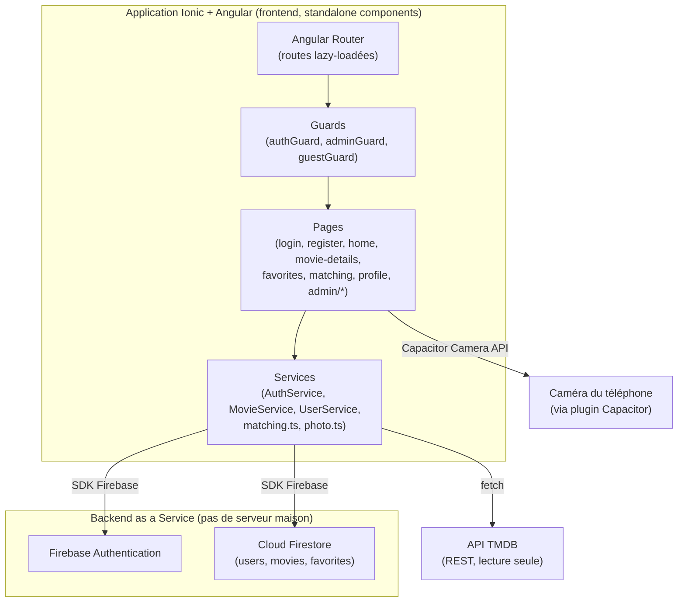
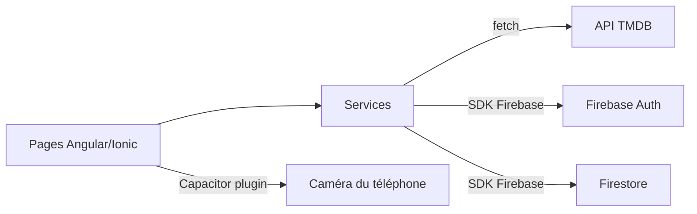

# Dossier de préparation à la validation — CineMatch (Ionic + Angular)

> Document préparé à partir de l'analyse réelle du code du projet `movie-app` (CineMatch).
> Aucune fonctionnalité n'a été inventée ni ajoutée : tout ce qui est décrit ici correspond au code existant au moment de la rédaction. Quand une technologie citée dans le sujet du cours n'est **pas** utilisée dans le projet (Firebase Storage, Angular HttpClient, RxJS/Observable), cela est signalé explicitement plutôt que d'être présenté comme si elle l'était.

---

## Table des matières

1. [Analyse complète du projet](#1-analyse-complète-du-projet)
2. [Documentation technique détaillée](#2-documentation-technique-détaillée)
3. [Explication du code source](#3-explication-du-code-source)
4. [Préparation aux questions du professeur](#4-préparation-aux-questions-du-professeur)
5. [Scénario de démonstration pratique](#5-scénario-de-démonstration-pratique)
6. [Comparaisons techniques](#6-comparaisons-techniques)
7. [Fiche de révision finale](#7-fiche-de-révision-finale)

---

## 1. Analyse complète du projet

### 1.1 Structure réelle des dossiers

```
movie-app/
├── src/
│   ├── app/
│   │   ├── config.ts                 # Config Firebase + clé API TMDB
│   │   ├── firebase.ts               # Initialisation de Firebase (auth, db)
│   │   ├── models.ts                 # Interfaces TypeScript (UserProfile, Movie, Favorite)
│   │   ├── guards.ts                 # authGuard, adminGuard, guestGuard
│   │   ├── app.routes.ts             # Toutes les routes de l'application
│   │   ├── app.component.ts/.html    # Composant racine (<ion-app>)
│   │   ├── services/
│   │   │   ├── auth.service.ts       # Inscription, connexion, déconnexion, profil courant
│   │   │   ├── user.service.ts       # Liste des utilisateurs, activation/désactivation (admin)
│   │   │   ├── movie.service.ts      # Appels TMDB, catalogue admin, favoris
│   │   │   ├── matching.ts           # Algorithme de matching (fonctions pures)
│   │   │   ├── matching.spec.ts      # Tests unitaires de l'algorithme
│   │   │   └── photo.ts              # Capture et redimensionnement de la photo (Capacitor Camera)
│   │   └── pages/
│   │       ├── login/                # Connexion
│   │       ├── register/             # Inscription (+ photo caméra)
│   │       ├── tabs/                 # Barre d'onglets (ion-tabs)
│   │       ├── home/                 # Catalogue TMDB + recherche
│   │       ├── movie-details/        # Détails d'un film + favoris
│   │       ├── favorites/            # Liste des favoris de l'utilisateur
│   │       ├── matching/             # Résultats de matching
│   │       ├── profile/              # Profil utilisateur
│   │       └── admin/                # Dashboard, gestion utilisateurs, ajout de film
│   ├── environments/                 # production / development (flag `production` uniquement)
│   ├── main.ts                       # Point d'entrée (bootstrapApplication)
│   └── index.html
├── android/                          # Projet natif généré par Capacitor
├── firestore.rules                   # Règles de sécurité Firestore
├── capacitor.config.ts               # Configuration Capacitor (appId, appName, webDir)
└── package.json
```

### 1.2 Technologies et dépendances réellement utilisées

| Dépendance | Version | Rôle réel dans le projet |
|---|---|---|
| `@angular/core`, `common`, `forms`, `router`, `platform-browser` | 22.2.3 | Framework de base (composants standalone, signals, routeur) |
| `@ionic/angular` | ^9.0.0 | Composants UI mobiles (`ion-*`) + contrôleurs (`ToastController`, `AlertController`) |
| `@capacitor/core`, `@capacitor/cli`, `@capacitor/android` | 8.x | Pont entre le code web et la plateforme native |
| `@capacitor/camera` | ^8.2.6 | Accès à la caméra du téléphone |
| `@capacitor/app`, `haptics`, `keyboard`, `status-bar` | 8.x | Intégrations natives standard (non exploitées de façon spécifique dans le code applicatif) |
| `firebase` | ^13.2.0 | SDK JS pour Firebase Authentication et Cloud Firestore |
| `ionicons` | ^8.1.0 | Jeu d'icônes utilisé via `addIcons()` |
| `rxjs` | ~7.8.0 | Présent comme dépendance d'Angular (le routeur l'utilise en interne), **mais le code applicatif de ce projet n'utilise aucun `Observable` ni `.subscribe()` directement** — voir §2.B |
| `vitest`, `@angular/build` (test runner) | — | Tests unitaires (uniquement sur l'algorithme de matching) |

**Important à savoir pour la validation** : le projet **n'utilise pas** `HttpClient` d'Angular (les appels TMDB passent par la fonction native `fetch()`), **n'utilise pas** Firebase Storage (les photos sont stockées en base64 directement dans Firestore), et **n'utilise pas** `ModalController` ni de menu latéral (`ion-menu`) — la navigation se fait entièrement par onglets (`ion-tabs`). Il vaut mieux l'assumer clairement devant le professeur plutôt que de prétendre le contraire.

### 1.3 Rôle des fichiers importants

| Fichier | Rôle |
|---|---|
| [`src/app/firebase.ts`](src/app/firebase.ts) | Initialise l'app Firebase une seule fois, exporte `auth` et `db` utilisés partout ailleurs |
| [`src/app/guards.ts`](src/app/guards.ts) | Protège les routes selon l'état de connexion et le rôle |
| [`src/app/services/auth.service.ts`](src/app/services/auth.service.ts) | Cœur de l'authentification : inscription, connexion, écoute en temps réel de la désactivation |
| [`src/app/services/movie.service.ts`](src/app/services/movie.service.ts) | Tout ce qui touche aux films : TMDB, catalogue admin, favoris |
| [`src/app/services/matching.ts`](src/app/services/matching.ts) | Fonction pure `computeMatch()` qui calcule le score de compatibilité entre deux utilisateurs |
| [`firestore.rules`](firestore.rules) | Règles de sécurité qui définissent qui peut lire/écrire quoi dans Firestore |

---

## 2. Documentation technique détaillée

### A. Architecture de l'application

L'application suit une architecture **client-only** (pas de serveur applicatif propre à nous) : le frontend Ionic/Angular communique **directement** avec deux services externes.



- **Frontend** : toutes les pages (`pages/*.page.ts`) sont des **composants Angular standalone** — pas de "backend" Angular, juste des services injectés qui font les appels réseau.
- **"Backend"** : il n'y a pas de serveur Node/Express écrit par nous. Le rôle du backend est joué par **Firebase** (authentification + base de données) et par l'**API publique TMDB** (catalogue de films). C'est un choix assumé dans l'énoncé du projet ("Vos données seront stockées dans Firebase... ou dans une API").
- **Communication entre les parties** : une Page injecte un Service avec `inject()`, appelle une méthode `async`, attend le résultat avec `await`, et met à jour un `signal` qui réaffiche automatiquement le template (réactivité Angular par signals, pas par `Observable`).
- **Routage et navigation** : `app.routes.ts` définit toutes les routes avec `loadComponent` (lazy loading). Les pages protégées sont sous `/tabs/...` et passent par `authGuard` ; les pages admin passent en plus par `adminGuard`.

### B. Technologies utilisées

#### Ionic
**Qu'est-ce que c'est ?** Une bibliothèque de composants d'interface (`ion-button`, `ion-input`, `ion-tabs`, etc.) construits avec les Web Components, pensés pour ressembler à des composants natifs mobiles.
**À quoi ça sert ici ?** Toute l'interface visuelle de CineMatch est faite avec des balises Ionic : écrans de connexion ([login.page.html](src/app/pages/login/login.page.html)), listes de films ([home.page.html](src/app/pages/home/home.page.html)), barre d'onglets ([tabs.page.ts](src/app/pages/tabs/tabs.page.ts)), etc.
**Comment ça communique avec Angular ?** Le package `@ionic/angular` enregistre les composants Ionic comme des composants Angular utilisables dans les templates, et expose des **contrôleurs** injectables (`ToastController`, `AlertController`) utilisés par exemple dans [favorites.page.ts](src/app/pages/favorites/favorites.page.ts) pour demander confirmation avant de supprimer un favori.

#### Angular
**Qu'est-ce que c'est ?** Framework JavaScript/TypeScript pour construire des applications web structurées en composants.
**Pourquoi dans ce projet ?** C'est le framework choisi parmi les options proposées (JS/Angular/React/Vue) pour sa structure claire (composants, services, routage, injection de dépendances) et son intégration native avec Ionic.
**Comment ça fonctionne ici ?** Chaque page est un `@Component` **standalone** (pas de `NgModule`), avec son propre tableau `imports`. L'état réactif est géré par des **signals** (`signal()`, `computed()`) plutôt que par `Observable` — c'est l'API moderne d'Angular (depuis Angular 16+, généralisée dans les versions récentes comme la 22 utilisée ici).

#### TypeScript
**Qu'est-ce que c'est ?** Un sur-ensemble de JavaScript qui ajoute le typage statique.
**Pourquoi ici ?** Angular l'impose. Il sert à définir des contrats de données stricts : voir [models.ts](src/app/models.ts) où `UserProfile`, `Movie` et `Favorite` sont des `interface` qui décrivent exactement la forme des documents Firestore.
**Différence avec JavaScript** : voir le tableau comparatif en §6.

#### HTML et CSS (SCSS)
Chaque page utilise soit un template inline (`template: \`...\``, ex. [tabs.page.ts](src/app/pages/tabs/tabs.page.ts)) soit un fichier séparé (`templateUrl`, ex. [home.page.html](src/app/pages/home/home.page.html)). Le style global est dans [global.scss](src/global.scss) et [theme/variables.scss](src/theme/variables.scss) (couleurs Ionic). Les classes utilitaires comme `.error-box`, `.list-card`, `.auth-box` sont réutilisées sur plusieurs pages.

#### Firebase Authentication
**Qu'est-ce que c'est ?** Service Google qui gère les comptes utilisateurs (email/mot de passe ici) sans qu'on ait à coder soi-même le hachage de mot de passe, les tokens, etc.
**Comment il est utilisé ?** Dans [auth.service.ts](src/app/services/auth.service.ts) : `createUserWithEmailAndPassword()` à l'inscription, `signInWithEmailAndPassword()` à la connexion, `signOut()` à la déconnexion, `onAuthStateChanged()` pour savoir en permanence si quelqu'un est connecté.

#### Cloud Firestore
**Qu'est-ce que c'est ?** Base de données NoSQL orientée documents, hébergée par Firebase.
**Comment elle est utilisée ?** Trois collections : `users`, `movies`, `favorites` (détail en §C). Les opérations utilisées sont `setDoc`, `getDoc`, `getDocs`, `addDoc`, `updateDoc`, `deleteDoc`, `query`/`where`, et `onSnapshot` (écoute en temps réel, utilisée pour détecter la désactivation d'un compte pendant qu'il est connecté).

#### Firebase Storage
**Non utilisé dans ce projet.** La photo de profil n'est **pas** envoyée vers Firebase Storage : elle est redimensionnée en petite image JPEG puis convertie en chaîne **base64 (data URL)**, stockée directement dans le champ `photoUrl` du document utilisateur Firestore (voir [photo.ts](src/app/services/photo.ts) et §F). Le README du projet explique ce choix : éviter Storage, qui nécessite le plan payant sur les nouveaux projets Firebase.

#### API TMDB
Détaillé en §D.

#### Capacitor
**Qu'est-ce que c'est ?** Le framework (successeur de Cordova) qui permet d'empaqueter une application web Ionic/Angular en application native (Android/iOS), et d'accéder aux fonctionnalités du téléphone (caméra, etc.) via des plugins JavaScript.
**Pourquoi avec Ionic ?** Ionic fournit l'UI, Capacitor fournit le pont vers le natif. Sans Capacitor, l'app ne pourrait tourner que dans un navigateur, sans accès à la vraie caméra du téléphone.
**Dans ce projet** : `capacitor.config.ts` définit `appId: 'com.cinematch.app'`, `webDir: 'www'`. Le dossier `android/` a été généré par `npx cap add android` et contient le projet natif Android Studio.

#### Capacitor Camera
Plugin utilisé dans [photo.ts](src/app/services/photo.ts) via `Camera.takePhoto({...})`. Détaillé en §F.

#### Angular Services
**Qu'est-ce que c'est ?** Une classe annotée `@Injectable()` qui centralise une logique réutilisable (accès aux données, calculs) indépendamment de l'affichage.
**Dans ce projet** : `AuthService`, `MovieService`, `UserService` sont tous déclarés `@Injectable({ providedIn: 'root' })`, ce qui veut dire qu'**une seule instance** est partagée dans toute l'application (singleton).

#### Injection de dépendances (Dependency Injection)
Angular fournit automatiquement une instance de service à qui en a besoin, sans que le composant ait à faire `new MovieService()` lui-même. Dans ce projet, le style utilisé est la fonction `inject()` (API moderne), par exemple dans [favorites.page.ts](src/app/pages/favorites/favorites.page.ts) :
```ts
private movieService = inject(MovieService);
private auth = inject(AuthService);
private alertCtrl = inject(AlertController);
```

#### RxJS et Observables
**Non utilisés directement dans le code applicatif de ce projet.** Angular et son routeur s'appuient sur RxJS en interne, mais aucune page ni service du projet ne crée ou ne `.subscribe()` à un `Observable` : toute la logique asynchrone (appels TMDB, Firestore, Auth) est écrite avec des **`Promise` et `async/await`**. Même la récupération du paramètre de route `:id` dans [movie-details.page.ts](src/app/pages/movie-details/movie-details.page.ts) n'utilise pas `ActivatedRoute.paramMap.subscribe(...)` mais la liaison moderne **component input binding** (`id = input.required<string>()`), activée par `withComponentInputBinding()` dans [main.ts](src/main.ts). C'est un point à assumer clairement si le professeur pose la question.

#### HTTP Client
**Non utilisé.** Les appels à l'API TMDB passent par la fonction native du navigateur `fetch()`, pas par `HttpClientModule`/`HttpClient` d'Angular. Voir la méthode privée `tmdb()` dans [movie.service.ts](src/app/services/movie.service.ts).

#### Angular Guards
Trois guards fonctionnels (`CanActivateFn`) dans [guards.ts](src/app/guards.ts) :
- `authGuard` : bloque l'accès à `/tabs/*` si l'utilisateur n'est pas connecté ou désactivé.
- `adminGuard` : bloque `/tabs/admin*` si le rôle n'est pas `admin`.
- `guestGuard` : empêche d'accéder à `/login` ou `/register` si déjà connecté.

### C. Firebase et base de données

**Firebase** est une plateforme Google qui fournit des services prêts à l'emploi (authentification, base de données, hébergement...) pour éviter d'écrire un serveur complet soi-même — on parle de *Backend as a Service* (BaaS).

**Firestore** est la base de données NoSQL de Firebase. Contrairement à une base SQL (tables/lignes/colonnes avec un schéma fixe), Firestore stocke des **documents** (objets JSON-like) regroupés dans des **collections**. Il n'y a pas de schéma imposé au niveau de la base : la structure est celle que le code impose via les interfaces TypeScript.

- **Collection** = un ensemble de documents du même type (ex. `users`).
- **Document** = un enregistrement individuel, identifié par un `id` unique, contenant des paires champ/valeur.

#### Structure réelle de la base (3 collections)

**`users`** — id du document = `uid` Firebase Auth (voir [models.ts](src/app/models.ts))
```json
{
  "uid": "ab12cd34...",
  "firstName": "Sarra",
  "lastName": "Ben Ali",
  "age": 23,
  "email": "sarra@example.com",
  "photoUrl": "data:image/jpeg;base64,/9j/4AAQSkZJRg...",
  "role": "user",
  "isActive": true
}
```

**`movies`** — id auto-généré, films ajoutés par l'admin (voir [movie.service.ts](src/app/services/movie.service.ts))
```json
{
  "title": "Dune",
  "poster": "https://image.tmdb.org/t/p/w500/xxx.jpg",
  "releaseDate": "2021-09-15",
  "genres": ["Science Fiction", "Adventure"],
  "actors": ["Timothée Chalamet", "Zendaya"],
  "overview": "...",
  "createdAt": 1731000000000
}
```

**`favorites`** — id du document = `"<userId>_<movieId>"` (composite, pas auto-généré)
```json
{
  "userId": "ab12cd34...",
  "movieId": "438631",
  "title": "Dune",
  "poster": "https://image.tmdb.org/t/p/w500/xxx.jpg",
  "releaseDate": "2021-09-15",
  "genres": ["Science Fiction", "Adventure"],
  "actors": ["Timothée Chalamet", "Zendaya"],
  "addedAt": 1731000500000
}
```

#### Pourquoi l'id composite `userId_movieId` ?
Deux raisons concrètes dans le code :
1. **Empêcher les doublons** : si l'utilisateur clique deux fois sur "Add to favorites", `setDoc` sur le même id écrase simplement le document existant au lieu d'en créer un deuxième.
2. **Vérifier l'appartenance facilement** dans les règles Firestore : `favId == request.auth.uid + '_' + request.resource.data.movieId` garantit qu'on ne peut créer un favori qu'avec son propre `uid` en préfixe.

#### Pourquoi la copie des champs film (title, genres, actors...) dans `favorites` ?
Pour que la page de matching n'ait besoin que de **2 requêtes** (tous les utilisateurs + tous les favoris) au lieu de devoir rappeler l'API TMDB pour chaque film de chaque utilisateur. C'est une **dénormalisation volontaire**, typique du NoSQL (contrairement au SQL où on éviterait la duplication avec une jointure).

#### Lien entre users / movies / favorites
`favorites.userId` référence `users.uid` (mais il n'y a pas de vraie "clé étrangère" en NoSQL — c'est juste une convention appliquée par le code et vérifiée par les règles de sécurité). `favorites.movieId` référence soit l'id numérique TMDB, soit l'id Firestore d'un document `movies`.

#### CRUD réel (Create / Read / Update / Delete)
| Opération | Fonction | Fichier |
|---|---|---|
| Create (compte) | `setDoc(doc(db,'users',uid), profile)` | `auth.service.ts` → `register()` |
| Read (profil) | `getDoc(doc(db,'users',uid))` | `auth.service.ts` → `login()` |
| Update (profil) | `updateDoc(doc(db,'users',uid), changes)` | `auth.service.ts` → `updateMyProfile()` |
| Create (film catalogue) | `addDoc(collection(db,'movies'), movie)` | `movie.service.ts` → `addToCatalog()` |
| Create (favori) | `setDoc(doc(db,'favorites',favId), favorite)` | `movie.service.ts` → `addFavorite()` |
| Delete (favori) | `deleteDoc(doc(db,'favorites',favId))` | `movie.service.ts` → `removeFavorite()` |
| Update (activation) | `updateDoc(doc(db,'users',uid), {isActive})` | `user.service.ts` → `setActive()` |

**Il n'y a volontairement aucun `deleteDoc` sur `users`** : les règles Firestore interdisent explicitement `allow delete: if false;` sur la collection `users`, ce qui correspond exactement à la consigne "désactiver et pas supprimer".

#### Rôles utilisateur et administrateur
Le champ `role: 'user' | 'admin'` dans le document `users` détermine le rôle. Il n'existe **pas** de mécanisme Firebase séparé pour les rôles (pas de "custom claims") — c'est un simple champ Firestore, protégé par les règles de sécurité (`request.resource.data.role == resource.data.role` empêche un utilisateur normal de se promouvoir admin lui-même). Pour créer le premier admin, il faut changer ce champ manuellement depuis la console Firebase.

#### Désactivation d'un compte
Le champ `isActive: boolean` contrôle l'accès :
1. L'admin bascule `isActive` à `false` via [admin-users.page.ts](src/app/pages/admin/admin-users.page.ts).
2. Si l'utilisateur désactivé est **en train d'utiliser l'app**, un `onSnapshot` sur son propre document (mis en place dans `auth.service.ts`) détecte le changement **en temps réel** et le déconnecte immédiatement avec un message ("Your account has been deactivated by an administrator.").
3. S'il tente de se reconnecter, `login()` vérifie `profile.isActive` et refuse avec `signOut()` + erreur.
4. Les règles Firestore bloquent aussi tout accès aux données pour un compte inactif (`isActive()` est utilisé comme condition dans presque toutes les règles).

### D. Intégration de l'API TMDB

**API** = Interface de Programmation — un ensemble de points d'entrée (ici des URLs) qu'un programme peut appeler pour obtenir des données, sans connaître les détails internes du système qui les fournit.
**API REST** = une API qui utilise le protocole HTTP de façon standardisée (GET pour lire, POST pour créer, etc.), avec des données généralement au format JSON.
**TMDB** (The Movie Database) = une base de données collaborative de films, qui expose une API REST publique et gratuite.

#### Comment l'app communique avec TMDB
Tout passe par une seule méthode privée dans [movie.service.ts](src/app/services/movie.service.ts) :
```ts
private async tmdb(path: string, params: Record<string, string> = {}): Promise<any> {
  const url = new URL(TMDB_URL + path);
  url.searchParams.set('api_key', tmdbApiKey);
  for (const [key, value] of Object.entries(params)) url.searchParams.set(key, value);

  const res = await fetch(url);
  if (!res.ok) throw new Error(`TMDB request failed (${res.status}). Check your TMDB API key.`);
  return res.json();
}
```
C'est une requête **GET** (lecture seule — l'app ne crée ni ne modifie jamais rien sur TMDB, donc **pas de POST** vers TMDB dans ce projet).

#### Récupération des films
- `popular(page)` → appelle `/movie/popular` → films populaires, paginés.
- `search(text, page)` → appelle `/search/movie?query=...` → recherche par texte.
- `getMovie(id)` → si `id` est numérique (`/^\d+$/`), appelle `/movie/{id}?append_to_response=credits` (détails + casting en une seule requête) ; sinon, c'est un film ajouté par l'admin, donc lecture directe dans Firestore (`movies/{id}`).

#### Genres et acteurs
Ils arrivent directement dans la réponse JSON de TMDB et sont transformés par `fromTmdb()` :
```ts
private fromTmdb(m: any): Movie {
  return {
    id: String(m.id),
    title: m.title,
    poster: m.poster_path ? TMDB_IMG + m.poster_path : '',
    releaseDate: m.release_date ?? '',
    genres: (m.genres ?? []).map((g: any) => g.name),
    actors: (m.credits?.cast ?? []).slice(0, 10).map((c: any) => c.name),
    overview: m.overview ?? '',
  };
}
```
→ on ne garde que les **10 premiers acteurs** du casting (`.slice(0, 10)`), et seulement leur **nom** (pas leur photo ni leur rôle).

#### Format JSON
JSON (JavaScript Object Notation) est le format texte utilisé par TMDB (et par Firestore en interne) pour représenter des données structurées — objets `{...}`, tableaux `[...]`, chaînes, nombres, booléens. `res.json()` transforme la réponse HTTP brute en objet JavaScript utilisable directement.

#### GET vs POST
| | GET | POST |
|---|---|---|
| Usage dans ce projet | Toutes les requêtes TMDB (lecture) | Aucune requête TMDB. Firestore utilise son propre SDK (pas du HTTP manuel), mais conceptuellement `addDoc`/`setDoc` correspondent à des écritures, équivalent logique d'un POST/PUT |
| Paramètres | Dans l'URL (`?query=...`) | Dans le corps de la requête |

#### Traitement et affichage des réponses
Les pages n'appellent jamais `fetch` directement : elles appellent `MovieService.popular()`/`search()`, reçoivent un tableau de `Movie` déjà typé, et l'affichent avec `@for` dans le template (ex. [home.page.html](src/app/pages/home/home.page.html)), avec un `ion-spinner` pendant le chargement et un message d'erreur si `fetch` échoue (clé API invalide, pas de réseau...).

### E. Authentification et autorisation

**Authentification** = vérifier **qui** est l'utilisateur (son identité — email + mot de passe ici).
**Autorisation** = vérifier **ce qu'il a le droit de faire** une fois identifié (accéder à telle page, modifier telle donnée). Dans ce projet, l'autorisation repose sur deux éléments : le champ `role` (user/admin) et le champ `isActive`.

Déroulé réel du code, étape par étape :

1. **Inscription** ([register.page.ts](src/app/pages/register/register.page.ts)) : validation des champs (nom/prénom non vides, âge entre 1 et 120, mot de passe ≥ 6 caractères, photo obligatoire), puis appel à `AuthService.register()`.
2. **Création du compte Firebase Auth** : `createUserWithEmailAndPassword(auth, email, password)` → Firebase crée un compte et renvoie un objet `cred.user` avec un `uid` unique.
3. **Enregistrement dans Firestore** : `setDoc(doc(db,'users', cred.user.uid), profile)` avec `role:'user'` et `isActive:true` forcés côté code (et re-vérifiés côté règles de sécurité).
4. **Connexion** ([login.page.ts](src/app/pages/login/login.page.ts)) : `signInWithEmailAndPassword(auth, email, password)`.
5. **Récupération des infos** : `getDoc(doc(db,'users', cred.user.uid))` pour charger le profil complet (nom, rôle, etc.), stocké dans le `signal profile`.
6. **Vérification du rôle/statut** : si `!profile.isActive`, déconnexion immédiate (`signOut`) avec message d'erreur, avant même d'arriver dans l'app.
7. **Accès aux pages autorisées** : les guards (`authGuard`, `adminGuard`) lisent `auth.profile()` pour décider si la navigation est autorisée.
8. **Déconnexion** : `logout()` arrête l'écoute Firestore en cours, remet `profile` à `null`, appelle `signOut(auth)`, puis redirige vers `/login`.
9. **Désactivation** : voir §C — détection en direct via `onSnapshot`, déconnexion forcée.

### F. Utilisation de la caméra

Déjà introduit en §B. Détail du fonctionnement réel dans [photo.ts](src/app/services/photo.ts) :

```ts
export async function takeProfilePhoto(): Promise<string> {
  const photo = await Camera.takePhoto({
    quality: 80,
    targetWidth: 600,
    targetHeight: 600,
    cameraDirection: CameraDirection.Front,
  });
  const src = photo.webPath ?? (photo.thumbnail ? 'data:image/jpeg;base64,' + photo.thumbnail : '');
  if (!src) throw new Error('No photo returned by the camera.');
  return resizeImage(src, 300);
}
```

1. **Accès à la caméra** : `Camera.takePhoto({...})` — plugin Capacitor qui ouvre l'interface caméra native (ou la webcam dans un navigateur, via `@ionic/pwa-elements`), caméra **frontale** demandée par défaut (`CameraDirection.Front`, logique pour une photo de profil).
2. **Récupération de l'image** : `photo.webPath` (chemin utilisable dans une balise ``).
3. **Redimensionnement/stockage** : `resizeImage()` dessine l'image sur un `<canvas>` HTML, la réduit à 300px maximum, et exporte le résultat en JPEG compressé via `canvas.toDataURL('image/jpeg', 0.7)` → une chaîne **base64** d'environ 20-40 Ko.
4. **Pourquoi redimensionner ?** Firestore limite chaque document à 1 Mo ; une photo brute de smartphone dépasserait largement cette limite.
5. **Affichage dans le profil** : la chaîne base64 est stockée directement dans `photoUrl` et affichée avec `` — un navigateur/WebView affiche une `data:` URL exactement comme une URL classique, sans requête réseau supplémentaire.

### G. Gestion des favoris

Dans [movie.service.ts](src/app/services/movie.service.ts) :

- **Ajouter** : `addFavorite(userId, movie)` construit un objet `Favorite` (copie des champs du film + `addedAt: Date.now()`) et fait `setDoc(doc(db,'favorites', favId(userId, movie.id)), favorite)`.
- **Enregistrer** : l'id du document garantit l'unicité (`userId_movieId`) — pas de doublon possible.
- **Récupérer les favoris d'un utilisateur** : `getFavorites(userId)` fait une requête filtrée `query(collection(db,'favorites'), where('userId','==',userId))`, triée par date décroissante.
- **Supprimer** : `removeFavorite(userId, movieId)` → `deleteDoc(doc(db,'favorites', favId(userId, movieId)))`.
- **Garantir que chaque utilisateur a sa propre playlist** : c'est assuré à **deux niveaux**. Côté code, chaque appel passe l'`userId` courant. Côté sécurité (ce qui compte vraiment, car le code client n'est pas fiable), les règles Firestore imposent :
```
allow create: if isActive()
  && request.resource.data.userId == request.auth.uid
  && favId == request.auth.uid + '_' + request.resource.data.movieId;
allow delete: if isActive() && resource.data.userId == request.auth.uid;
```
→ impossible d'ajouter ou de supprimer un favori au nom de quelqu'un d'autre, même en modifiant le code JavaScript côté client.

### H. Algorithme de matching

C'est la partie la plus "logique métier" du projet — fonction pure, sans effet de bord, entièrement testée unitairement dans [matching.spec.ts](src/app/services/matching.spec.ts). Code réel dans [matching.ts](src/app/services/matching.ts).

#### Les 4 critères comparés
| Critère | Poids | Ce qui est comparé |
|---|---|---|
| Films communs | 35 % | Les films présents dans les deux listes de favoris |
| Genres communs | 30 % | Tous les genres des films favoris de chacun (à plat) |
| Acteurs communs | 20 % | Tous les acteurs des films favoris de chacun (à plat, max 10 par film car limité en amont par TMDB) |
| Années proches | 15 % | Moyenne des années de sortie des favoris de chacun |

#### La méthode de comparaison : l'indice de Jaccard
Pour films, genres et acteurs, on calcule :
```
Jaccard(A, B) = |A ∩ B| / |A ∪ B|
```
(taille de l'intersection divisée par la taille de l'union). Résultat entre 0 (rien en commun) et 1 (ensembles identiques).

```ts
function jaccard(a: Set<string>, b: Set<string>): number {
  const union = new Set([...a, ...b]);
  if (union.size === 0) return 0;
  return intersect(a, b).length / union.size;
}
```

**Pourquoi Jaccard et pas un simple comptage ?** Parce que partager 3 films sur 3 (listes identiques) est beaucoup plus significatif que partager 3 films sur 50. Le comptage brut ne fait pas cette distinction ; Jaccard, si.

#### Le critère "années"
```ts
years: myAvgYear === null || theirAvgYear === null
  ? 0
  : Math.max(0, 1 - Math.abs(myAvgYear - theirAvgYear) / YEAR_RANGE)
```
avec `YEAR_RANGE = 20`. Si les moyennes d'années sont égales → 1 (score plein). Si elles sont distantes de 20 ans ou plus → 0 (aucune similarité temporelle). Entre les deux, décroissance linéaire.

#### La formule finale
```ts
score = 100 * (0.35·moviesJaccard + 0.30·genresJaccard + 0.20·actorsJaccard + 0.15·yearsScore)
```
arrondi à l'entier (`Math.round`). Un utilisateur n'est affiché comme "match" que si `score > 75` (`MATCH_THRESHOLD`).

#### Exemple réel, calculé étape par étape (tiré directement des données de test du projet — `matching.spec.ts`)

Films utilisés dans les tests :
| Id | Titre | Année | Genres | Acteurs |
|---|---|---|---|---|
| 1 | Inception | 2010 | Action, Sci-Fi, Adventure | Leonardo DiCaprio, Tom Hardy |
| 2 | Interstellar | 2014 | Drama, Sci-Fi | Matthew McConaughey, Anne Hathaway |
| 3 | The Dark Knight | 2008 | Action, Crime | Christian Bale, Heath Ledger, Tom Hardy |
| 4 | The Revenant | 2015 | Drama, Western, Adventure | Leonardo DiCaprio, Tom Hardy |

**"Moi"** = favoris [1, 2, 3, 4] — **"Utilisateur B"** = favoris [1, 2, 3] (3 des 4 films de "Moi")

**1) Films**
- Moi = {1,2,3,4}, B = {1,2,3} → intersection = {1,2,3} = 3, union = {1,2,3,4} = 4
- Jaccard films = 3/4 = **0,75**

**2) Genres**
- Moi (tous les genres des 4 films) = {Action, Sci-Fi, Adventure, Drama, Crime, Western} = 6 genres distincts
- B (3 films) = {Action, Sci-Fi, Adventure, Drama, Crime} = 5 genres distincts (sous-ensemble de ceux de Moi)
- intersection = 5, union = 6 → Jaccard genres = 5/6 ≈ **0,833**

**3) Acteurs**
- Moi = {Leonardo DiCaprio, Tom Hardy, Matthew McConaughey, Anne Hathaway, Christian Bale, Heath Ledger} = 6 acteurs distincts
- B (3 films) = exactement le même ensemble de 6 acteurs (le 4e film de Moi ne rajoute aucun nouvel acteur)
- intersection = 6, union = 6 → Jaccard acteurs = 6/6 = **1,0**

**4) Années**
- Moyenne de Moi = (2010+2014+2008+2015)/4 = 2011,75
- Moyenne de B = (2010+2014+2008)/3 ≈ 2010,67
- Différence = |2011,75 − 2010,67| ≈ 1,08
- Score années = 1 − 1,08/20 ≈ **0,946**

**5) Score final**
```
score = 100 × (0.35×0.75 + 0.30×0.833 + 0.20×1.0 + 0.15×0.946)
      = 100 × (0.2625 + 0.25 + 0.20 + 0.142)
      = 100 × 0.8545
      ≈ 85 %
```
→ **85 % > 75 %** : les deux utilisateurs sont affichés comme compatibles. C'est exactement le résultat vérifié par le test `expect(...).toBeGreaterThan(MATCH_THRESHOLD)`.

#### Deuxième exemple (pour montrer un cas qui échoue), même base
**"Moi"** = [1, 2, 3, 4] — **"Utilisateur C"** = favoris très différents = [Inception, Interstellar, Frozen, Casablanca] (seulement 2 films communs sur 6 au total, genres/acteurs/époques éloignés). Le calcul détaillé (même méthode) donne : Jaccard films = 2/6 ≈ 0,33, genres ≈ 0,44, acteurs = 0,5, années (Casablanca = 1942, très ancien) → score années ≈ 0,15.
```
score ≈ 100 × (0.35×0.33 + 0.30×0.44 + 0.20×0.5 + 0.15×0.15) ≈ 37 %
```
→ **37 % < 75 %** : pas affiché comme match. Confirmé par le test `expect(...).toBeLessThan(MATCH_THRESHOLD)`.

#### Cas particuliers gérés par le code
| Cas | Comportement réel |
|---|---|
| Aucune préférence commune du tout | `jaccard()` retourne 0 si l'intersection est vide → score tiré uniquement vers le bas par les autres critères |
| Les deux playlists sont vides | `union.size === 0` → `jaccard` retourne 0 directement (pas de division par zéro) ; testé explicitement (`computeMatch([], []).score === 0`) |
| Date de sortie manquante/vide | `parseInt('')` → `NaN`, filtré par `.filter(y => !isNaN(y))` dans `averageYear()` ; si **aucune** année valide pour un utilisateur, `averageYear` renvoie `null` et le critère années vaut 0 |
| Écart d'années ≥ 20 ans | `Math.max(0, ...)` empêche un score négatif, le critère années est simplement plafonné à 0 |

#### Justification du choix de cette méthode
- Jaccard est une métrique standard, simple à expliquer et à vérifier à la main (contrairement à des méthodes de similarité plus complexes type cosinus sur vecteurs pondérés).
- La pondération (35/30/20/15) privilégie les films exacts en commun tout en laissant les genres/acteurs/années "rattraper" un score quand peu de films se recoupent — ce qui répond directement à la consigne du professeur ("ne doit pas reposer uniquement sur les films favoris").
- Le seuil de 75 % filtre les faux positifs (ex. deux personnes qui n'ont qu'un vague point commun) tout en restant atteignable, comme le montre l'exemple ci-dessus (85 % avec 3 films communs sur 4).

---

## 3. Explication du code source

### 3.1 Fonctions les plus importantes

#### `register()` — Inscription
- **Fichier** : [auth.service.ts](src/app/services/auth.service.ts)
- **Objectif** : créer un compte Firebase Auth + le document Firestore associé
- **Paramètres** : `data: Omit<UserProfile,'uid'|'role'|'isActive'>` (prénom, nom, âge, email, photoUrl), `password: string`
- **Retour** : `Promise<void>`
- **Fonctionnement** :
```ts
async register(data, password) {
  const cred = await createUserWithEmailAndPassword(auth, data.email, password);
  const profile: UserProfile = { ...data, uid: cred.user.uid, role: 'user', isActive: true };
  await setDoc(doc(db, 'users', profile.uid), profile);
  this.profile.set(profile);
}
```
1. Crée le compte via Firebase Auth → récupère `cred.user.uid`.
2. Construit l'objet `profile` complet en forçant `role:'user'` et `isActive:true` (impossible de s'inscrire directement admin).
3. L'enregistre dans Firestore avec `setDoc` (id = `uid`).
4. Met à jour le `signal profile` → toute l'UI qui dépend de `auth.profile()` se met à jour automatiquement.
- **Appelée par** : `RegisterPage.register()`.

#### `login()` — Connexion
- **Fichier** : `auth.service.ts`
- **Paramètres** : `email: string`, `password: string`
- **Retour** : `Promise<void>` (lève une erreur si identifiants invalides, profil introuvable, ou compte désactivé)
- **Fonctionnement** : authentifie via Firebase, récupère le profil Firestore, vérifie `isActive`, sinon déconnecte immédiatement et lève une erreur explicite.
- **Appelée par** : `LoginPage.login()`.

#### `logout()` — Déconnexion
- **Fichier** : `auth.service.ts`
- **Fonctionnement** : arrête l'écoute `onSnapshot` en cours (`stopProfileListener`), vide `profile`, appelle `signOut(auth)`, redirige vers `/login`.
- **Appelée par** : `ProfilePage` (bouton Log out), et en interne par `auth.service.ts` lui-même quand une désactivation est détectée.

#### `popular()` / `search()` — Récupération et recherche de films
- **Fichier** : [movie.service.ts](src/app/services/movie.service.ts)
- **Paramètres** : `page: number` (et `text: string` pour `search`)
- **Retour** : `Promise<{movies: Movie[], totalPages: number}>`
- **Fonctionnement** : appelle `tmdb('/movie/popular', {page})` ou `tmdb('/search/movie', {query, page})`, transforme chaque résultat brut avec `fromTmdb()`.
- **Appelée par** : `HomePage.fetchPage()` (choisit l'une ou l'autre selon si une recherche est en cours).

#### `getMovie()` — Détails d'un film
- **Fichier** : `movie.service.ts`
- **Paramètre** : `id: string`
- **Fonctionnement** : si `id` est purement numérique → c'est un film TMDB, requête avec `append_to_response=credits` pour avoir le casting en une seule requête. Sinon → id Firestore, lecture directe dans `movies`.
- **Appelée par** : `MovieDetailsPage.ngOnInit()`.

#### `addFavorite()` / `removeFavorite()`
- **Fichier** : `movie.service.ts`
- **Fonctionnement** : détaillé en §2.G.
- **Appelées par** : `MovieDetailsPage.toggleFavorite()` / `addFavorite()` / `removeFavorite()`, et `FavoritesPage.remove()`.

#### `takeProfilePhoto()` — Capture photo
- **Fichier** : [photo.ts](src/app/services/photo.ts)
- **Retour** : `Promise<string>` (data URL JPEG)
- **Appelée par** : `RegisterPage.takePhoto()`, `ProfilePage.changePhoto()`.

#### `addToCatalog()` — Ajout de film par l'admin
- **Fichier** : `movie.service.ts`
- **Paramètre** : `movie: Omit<Movie,'id'>`
- **Fonctionnement** : `addDoc(collection(db,'movies'), {...movie, createdAt: Date.now()})` — id auto-généré par Firestore.
- **Appelée par** : `AddMoviePage.save()`.

#### `setActive()` — Désactivation d'utilisateur
- **Fichier** : [user.service.ts](src/app/services/user.service.ts)
- **Paramètres** : `uid: string`, `isActive: boolean`
- **Fonctionnement** : `updateDoc(doc(db,'users',uid), {isActive})`. Autorisé seulement pour un admin côté règles Firestore (`isAdmin()`).
- **Appelée par** : `AdminUsersPage.setActive()` (avec mise à jour optimiste de l'UI et rollback si erreur).

#### `computeMatch()` — Calcul du score de matching
- **Fichier** : [matching.ts](src/app/services/matching.ts)
- **Paramètres** : `mine: Favorite[]`, `theirs: Favorite[]`
- **Retour** : `MatchDetails` (score, détail par critère, listes des éléments communs, moyennes d'années)
- **Fonctionnement** : détaillé en §2.H.
- **Appelée par** : `MatchingPage.ionViewWillEnter()`, une fois pour chaque autre utilisateur actif.

### 3.2 Concepts Angular/TypeScript rencontrés dans le code

| Concept | Où on le voit | Explication rapide |
|---|---|---|
| **Component** | Toutes les pages (`@Component({...})`) | Classe + template + styles, unité de base de l'UI Angular |
| **Service** | `AuthService`, `MovieService`, `UserService` | Classe `@Injectable` pour la logique partagée/réutilisable |
| **Dependency Injection** | `inject(MovieService)` | Angular fournit l'instance sans `new` manuel |
| **Decorators** | `@Component`, `@Injectable` | Fonctions qui ajoutent des métadonnées à une classe |
| **Lifecycle Hooks** | `ngOnInit()` (ex. `MovieDetailsPage`), `ionViewWillEnter()` (ex. `FavoritesPage`, `MatchingPage`) | Méthodes appelées automatiquement à des moments précis du cycle de vie |
| **Routing** | `app.routes.ts`, `loadComponent` | Associe une URL à un composant, chargé en lazy loading |
| **Promise** | `async register(): Promise<void>` | Objet représentant un résultat futur (succès/échec) |
| **Async/Await** | Partout (`await createUserWithEmailAndPassword(...)`) | Syntaxe qui rend le code asynchrone lisible comme du code synchrone |
| **Interface** | `UserProfile`, `Movie`, `Favorite` (`models.ts`) | Contrat de typage, sans implémentation |
| **Type** | `role: 'user' \| 'admin'` | Union de types littéraux, restreint les valeurs possibles |
| **Constructor** | `constructor() { addIcons({...}); }` (`AppComponent`) | Code exécuté à la création de l'instance de la classe |
| **Observable** | **Non utilisé** dans le code applicatif (voir §2.B) | — |

---

## 4. Préparation aux questions du professeur

### Catégorie 1 : Questions générales

**Question : Quel est l'objectif de votre application ?**
*Réponse détaillée* : CineMatch permet à un utilisateur de parcourir un catalogue de films (via l'API TMDB + des films ajoutés par un administrateur), de créer sa propre liste de favoris, et de voir avec quels autres utilisateurs il partage des goûts similaires grâce à un algorithme de matching basé sur plusieurs critères.
*Réponse orale courte* : "C'est une appli qui permet de gérer des favoris de films et de trouver d'autres utilisateurs qui ont les mêmes goûts, un peu comme un système de recommandation social."
*Relance possible* : "Pourquoi avoir choisi le thème cinéma plutôt qu'un autre ?" → Parce que l'énoncé l'imposait directement, et que l'API TMDB est gratuite et bien documentée pour fournir une base de données de films réaliste.

**Question : Pourquoi avez-vous choisi Ionic ?**
*Réponse détaillée* : Ionic permet de développer une seule base de code web (HTML/CSS/TypeScript) et de la déployer à la fois sur Android, iOS et navigateur, avec des composants déjà stylés comme des composants natifs. Combiné à Capacitor, il donne aussi accès à la caméra du téléphone, exigée par l'énoncé.
*Réponse orale courte* : "Parce qu'on peut tout coder en Angular/TypeScript et obtenir une vraie appli Android sans réécrire de code natif, et parce que ça donne accès à la caméra via Capacitor."
*Relance* : "Quelle est la différence entre Ionic et Angular ?" → voir tableau comparatif §6.

**Question : Quelles sont les principales fonctionnalités ?**
*Réponse détaillée* : Inscription avec photo caméra, authentification, navigation/recherche dans le catalogue TMDB, gestion d'une playlist de favoris personnelle, algorithme de matching multi-critères (>75%), et côté administrateur : ajout de films et désactivation de comptes.
*Réponse orale courte* : liste simple des 6 points ci-dessus.
*Relance* : "Laquelle a été la plus difficile à implémenter ?" → L'algorithme de matching, car il fallait pondérer plusieurs critères (Jaccard sur ensembles) tout en gérant les cas limites (listes vides, aucune année connue).

**Question : Quelle architecture avez-vous utilisée ?**
*Réponse détaillée* : Une architecture client uniquement (pas de serveur maison), avec Angular/Ionic en frontend et Firebase (Auth + Firestore) comme backend as a service, plus l'API REST TMDB en lecture seule pour le catalogue de films.
*Réponse orale courte* : "Frontend Angular/Ionic, et pour le backend j'utilise directement Firebase plutôt que d'écrire mon propre serveur."
*Relance* : "Quelles sont les limites de cette architecture ?" → Toute la logique de sécurité repose sur les règles Firestore (pas de serveur pour valider/filtrer davantage), et certaines données (profils, favoris) sont lisibles par tout utilisateur actif pour permettre le calcul du matching côté client.

**Question : Pourquoi avoir choisi Firebase ?**
*Réponse détaillée* : Firebase fournit l'authentification et une base de données NoSQL en temps réel sans avoir à héberger ni sécuriser un serveur soi-même, avec un plan gratuit suffisant pour un projet étudiant, et un système de règles de sécurité déclaratif qui remplace une bonne partie de la logique serveur classique.
*Réponse orale courte* : "Parce que ça évite de monter un backend complet, et que l'énoncé l'autorisait explicitement comme option."
*Relance* : "Qu'auriez-vous fait différemment avec une vraie API ?" → Il aurait fallu coder soi-même l'authentification, la validation des données côté serveur, et la logique de permissions — Firebase fait tout ça via ses règles.

**Question : Qu'est-ce qui différencie votre projet d'une simple liste de films ?**
*Réponse détaillée* : La présence d'un vrai système multi-utilisateur avec rôles (admin/user), une sécurité appliquée au niveau de la base de données (et pas seulement dans l'interface), et surtout l'algorithme de matching qui croise plusieurs dimensions (films, genres, acteurs, années) plutôt qu'une simple comparaison de listes.
*Réponse orale courte* : "La gestion des rôles, la sécurité Firestore, et l'algorithme de matching multi-critères."
*Relance* : "Le matching pourrait-il être trompé facilement ?" → Oui, c'est un algorithme simple (Jaccard pondéré), pas un système d'apprentissage automatique ; il peut être amélioré, voir §7 (limites).

### Catégorie 2 : Ionic et Angular

**Question : Quelle est la différence entre Ionic et Angular ?**
*Réponse détaillée* : Angular est un framework complet pour structurer une application (composants, routage, services, injection de dépendances). Ionic est une bibliothèque de composants UI (boutons, listes, onglets...) pensée pour le mobile, qui s'appuie sur un framework comme Angular pour fonctionner — ce n'est pas un concurrent d'Angular mais un complément.
*Réponse orale courte* : "Angular structure la logique de l'appli, Ionic fournit les composants visuels adaptés au mobile."
*Relance* : "Est-ce qu'Ionic peut fonctionner sans Angular ?" → Oui, Ionic propose aussi des versions pour React, Vue, et même du JavaScript pur (ce que montrait le cours au chapitre précédent), mais ici on utilise la version Angular.

**Question : Qu'est-ce qu'un composant (Component) ?**
*Réponse détaillée* : Une unité d'interface réutilisable, combinant une classe TypeScript (logique), un template HTML (affichage) et éventuellement un fichier de styles. Dans ce projet, les composants sont **standalone** (pas regroupés dans un `NgModule`), chacun déclarant directement ses propres `imports`.
*Réponse orale courte* : "C'est un bloc d'interface avec sa logique et son HTML, par exemple la page `LoginPage`."
*Relance* : "Pourquoi 'standalone' plutôt que des `NgModule` ?" → C'est l'approche moderne recommandée par Angular depuis plusieurs versions, qui simplifie l'architecture et le lazy loading sans avoir à créer un module par page.

**Question : Qu'est-ce qu'un service ?**
*Réponse détaillée* : Une classe `@Injectable` qui centralise une logique indépendante de l'affichage (accès aux données, calculs), injectable dans n'importe quel composant qui en a besoin.
*Réponse orale courte* : "C'est là où vit la logique métier, par exemple `AuthService` pour tout ce qui touche à la connexion."
*Relance* : "Pourquoi ne pas mettre cette logique directement dans les pages ?" → Pour la réutiliser entre plusieurs pages (ex. `MovieService` est utilisé par `home`, `favorites`, `movie-details`, `matching`) et séparer clairement logique et affichage.

**Question : Qu'est-ce que l'injection de dépendances ?**
*Réponse détaillée* : Un mécanisme où Angular fournit automatiquement les instances de services dont une classe a besoin, plutôt que cette classe ne les crée elle-même avec `new`. Ça facilite les tests et évite de dupliquer les instances.
*Réponse orale courte* : "Au lieu de faire `new MovieService()`, j'écris `inject(MovieService)` et Angular me donne l'instance partagée."
*Relance* : "Est-ce qu'il existe plusieurs instances d'`AuthService` dans l'appli ?" → Non, `providedIn:'root'` en fait un singleton, une seule instance pour toute l'application.

**Question : Qu'est-ce que le routage (routing) ?**
*Réponse détaillée* : Le mécanisme qui associe une URL à un composant à afficher. Dans ce projet, `app.routes.ts` définit toutes les routes, avec `loadComponent` pour charger chaque page uniquement quand elle est visitée (lazy loading), et des `canActivate` (guards) sur les routes protégées.
*Réponse orale courte* : "Chaque URL correspond à une page, chargée seulement quand on y accède, avec des guards pour bloquer l'accès si besoin."
*Relance* : "Pourquoi le lazy loading ?" → Pour ne pas charger tout le code de l'application (toutes les pages) dès le démarrage, ce qui accélère le premier chargement.

**Question : Qu'est-ce qu'un Observable ?**
*Réponse détaillée* : Un flux de données asynchrone qui peut émettre plusieurs valeurs dans le temps (contrairement à une `Promise` qui se résout une seule fois). RxJS fournit cette abstraction. **Dans ce projet concret, aucun `Observable` n'est utilisé directement** : toute l'asynchronie passe par des `Promise`/`async-await`, et la réactivité de l'UI par des `signal()`.
*Réponse orale courte* : "C'est un flux de valeurs dans le temps, mais dans mon code je n'en utilise pas directement, je préfère les Promises et les signals."
*Relance* : "Le routeur Angular utilise-t-il des Observables ?" → En interne oui (ex. `router.events`), mais le code de ce projet ne s'y abonne jamais directement.

**Question : Quelle est la différence entre Promise et Observable ?**
*Réponse détaillée* : Une `Promise` représente une valeur unique, résolue ou rejetée une seule fois. Un `Observable` peut émettre zéro, une ou plusieurs valeurs dans le temps, et peut être annulé (`unsubscribe`). Ce projet utilise exclusivement des `Promise` (via `async/await`) car chaque opération — login, fetch TMDB, lecture Firestore — ne produit qu'un seul résultat.
*Réponse orale courte* : "Promise = un seul résultat futur ; Observable = un flux, potentiellement plusieurs valeurs dans le temps. J'utilise des Promises partout."
*Relance* : "Firestore ne propose-t-il pas une écoute en temps réel ?" → Si, `onSnapshot()`, utilisé une seule fois dans `auth.service.ts` pour détecter la désactivation en direct — c'est un callback, pas un Observable RxJS, mais le principe (plusieurs émissions dans le temps) est similaire.

**Question : Pourquoi utiliser TypeScript ?**
*Réponse détaillée* : TypeScript ajoute le typage statique à JavaScript, ce qui permet de détecter des erreurs (mauvais type, champ manquant) dès l'écriture du code plutôt qu'à l'exécution. Angular l'impose, et le projet en profite notamment via les interfaces `UserProfile`/`Movie`/`Favorite` qui garantissent la cohérence des données manipulées.
*Réponse orale courte* : "Ça évite les erreurs de type avant même d'exécuter le code, et ça rend le code plus lisible grâce aux interfaces."
*Relance* : voir tableau comparatif JS vs TS en §6.

### Catégorie 3 : Firebase et base de données

**Question : Qu'est-ce que Firebase ?**
*Réponse détaillée* : Une plateforme Google qui fournit des services backend prêts à l'emploi (authentification, base de données, hébergement, etc.) sans avoir à écrire et héberger son propre serveur.
*Réponse orale courte* : "C'est un backend tout fait fourni par Google, je l'utilise pour l'authentification et la base de données."
*Relance* : "Firebase est-il gratuit ?" → Il a un plan gratuit (Spark) suffisant pour ce projet ; certaines fonctionnalités comme Firebase Storage nécessitent le plan payant sur les nouveaux projets, ce qui explique pourquoi les photos sont stockées en base64 dans Firestore plutôt que dans Storage.

**Question : Qu'est-ce que Firestore ?**
*Réponse détaillée* : La base de données NoSQL orientée documents de Firebase, organisée en collections de documents JSON, interrogeable en temps réel, avec un système de règles de sécurité déclaratif.
*Réponse orale courte* : "C'est la base de données NoSQL de Firebase, où je stocke les utilisateurs, les films et les favoris."
*Relance* : "Firestore garantit-il un schéma ?" → Non, rien n'empêche techniquement un document d'avoir des champs différents des autres ; c'est le code TypeScript (les interfaces) et les règles de sécurité qui imposent la cohérence.

**Question : Quelle est la différence entre SQL et NoSQL ?**
voir tableau comparatif §6.

**Question : Qu'est-ce qu'une collection ?**
*Réponse détaillée* : Un ensemble de documents de même nature, l'équivalent approximatif d'une "table" en SQL mais sans schéma imposé. Ce projet a 3 collections : `users`, `movies`, `favorites`.
*Réponse orale courte* : "Un groupe de documents similaires, comme `users` qui contient tous les profils."

**Question : Qu'est-ce qu'un document ?**
*Réponse détaillée* : Un enregistrement individuel dans une collection, identifié par un id, contenant des paires champ/valeur (potentiellement imbriquées). Par exemple un document `users/ab12cd34` représente un utilisateur précis.
*Réponse orale courte* : "C'est une 'fiche' individuelle, l'équivalent d'une ligne en SQL mais en JSON."

**Question : Comment sont organisées les données de votre projet ?**
*Réponse détaillée* : voir le tableau en §2.C (3 collections, avec l'id composite `userId_movieId` pour les favoris et la duplication volontaire des champs film dans `favorites` pour limiter le nombre de requêtes lors du matching).
*Réponse orale courte* : résumer les 3 collections et pourquoi l'id composite existe.
*Relance* : "N'est-ce pas risqué de dupliquer les données du film dans chaque favori ?" → Le risque est que les données deviennent "périmées" si le film change sur TMDB, mais c'est un compromis assumé pour la performance (moins de requêtes), classique en NoSQL.

**Question : Comment protéger les données des utilisateurs ?**
*Réponse détaillée* : Via les règles de sécurité Firestore (`firestore.rules`), qui s'exécutent côté serveur Firebase et sont donc infalsifiables depuis le client. Elles vérifient systématiquement que l'utilisateur est connecté, actif, propriétaire de la donnée modifiée (ou admin), avant d'autoriser lecture/écriture.
*Réponse orale courte* : "J'utilise les règles de sécurité Firestore, qui s'exécutent côté serveur et empêchent qu'un utilisateur modifie les données d'un autre, même en trafiquant le code JS."
*Relance* : "Un utilisateur peut-il lire les données d'un autre ?" → Oui, en lecture seule : les profils et favoris d'autres utilisateurs actifs sont lisibles (nécessaire pour calculer le matching côté client), mais jamais modifiables. C'est documenté comme une simplification assumée dans le README du projet.

**Question : Comment avez-vous géré le fait qu'un utilisateur ne doit jamais devenir admin lui-même ?**
*Réponse détaillée* : La règle `allow update` sur `users` impose `request.resource.data.role == resource.data.role` pour un utilisateur normal — il peut modifier son profil mais pas son propre champ `role`. Seul un admin (vérifié par `isAdmin()`) peut modifier le rôle ou le statut de n'importe qui.
*Réponse orale courte* : "Les règles interdisent explicitement à un utilisateur de changer son propre champ `role`."

### Catégorie 4 : API et TMDB

**Question : Qu'est-ce qu'une API ?**
*Réponse détaillée* : Un ensemble de points d'accès qu'un programme expose pour que d'autres programmes puissent l'utiliser, sans connaître son fonctionnement interne.
*Réponse orale courte* : "Une interface qui permet à mon appli de demander des données à un autre système."

**Question : Qu'est-ce qu'une API REST ?**
*Réponse détaillée* : Une API qui respecte les conventions du protocole HTTP (verbes GET/POST/PUT/DELETE, ressources identifiées par URL, réponses généralement en JSON). TMDB en est un exemple.
*Réponse orale courte* : "Une API qui utilise les méthodes HTTP standard, et renvoie du JSON."

**Question : Comment récupérez-vous les films ?**
*Réponse détaillée* : via `fetch()` vers les endpoints `/movie/popular` et `/search/movie` de TMDB, avec la clé API en paramètre d'URL (`api_key`), détaillé en §2.D.
*Réponse orale courte* : résumer la méthode `tmdb()` et `popular()`/`search()`.

**Question : Comment gérez-vous les erreurs de l'API ?**
*Réponse détaillée* : `tmdb()` vérifie `res.ok` et lève une `Error` explicite si la requête échoue (mauvaise clé API, pas de réseau...). Cette erreur remonte jusqu'à la page (`HomePage.load()`), qui l'affiche dans un encadré rouge avec un bouton "Retry".
*Réponse orale courte* : "Si la requête échoue, une erreur est levée et affichée à l'utilisateur avec un bouton pour réessayer."

**Question : Qu'est-ce que JSON et pourquoi ce format ?**
*Réponse détaillée* : Format texte standard pour échanger des données structurées, directement convertible en objets JavaScript. TMDB (et Firestore en interne) l'utilisent car c'est le format d'échange web le plus répandu, léger et lisible.
*Réponse orale courte* : "C'est le format de données que TMDB renvoie, facile à transformer en objet JS avec `res.json()`."

**Question : Quelle est la différence entre GET et POST ?**
voir tableau comparatif §6.

### Catégorie 5 : Authentification et sécurité

**Question : Quelle est la différence entre authentification et autorisation ?**
*Réponse détaillée* : L'authentification vérifie l'identité (qui êtes-vous ?), l'autorisation vérifie les droits (qu'avez-vous le droit de faire ?). Dans le projet, Firebase Auth gère l'authentification ; le champ `role` + les règles Firestore gèrent l'autorisation.
*Réponse orale courte* : "L'authentification, c'est se connecter ; l'autorisation, c'est vérifier ce qu'on a le droit de faire une fois connecté."

**Question : Comment fonctionne Firebase Authentication dans votre projet ?**
*Réponse détaillée* : voir §2.E, déroulé complet inscription → connexion → déconnexion.
*Réponse orale courte* : résumer les étapes.

**Question : Qu'est-ce qu'un Guard ?**
*Réponse détaillée* : Une fonction associée à une route qui décide si la navigation est autorisée. Ici, les guards sont des `CanActivateFn` (fonctionnels, pas des classes) : `authGuard`, `adminGuard`, `guestGuard`.
*Réponse orale courte* : "Une fonction qui bloque ou autorise l'accès à une page avant qu'elle ne s'affiche."

**Question : Comment protégez-vous une page réservée à l'administrateur ?**
*Réponse détaillée* : La route est déclarée avec `canActivate: [adminGuard]` dans `app.routes.ts`. `adminGuard` vérifie `auth.profile()?.role === 'admin'`, sinon redirige vers `/tabs/home`. En parallèle, les règles Firestore vérifient aussi `isAdmin()` côté serveur pour les opérations d'écriture (ajout de film, changement de rôle/statut) — la protection n'est donc pas que côté interface.
*Réponse orale courte* : "Un guard Angular bloque l'accès à la page, et les règles Firestore bloquent aussi les écritures côté serveur, en double sécurité."
*Relance* : "Que se passerait-il si on retirait seulement le guard Angular ?" → L'utilisateur pourrait voir l'URL de la page admin s'afficher brièvement, mais toute tentative de lecture/écriture de données admin serait quand même refusée par les règles Firestore.

**Question : Comment distinguer un administrateur d'un utilisateur normal ?**
*Réponse détaillée* : Le champ `role: 'user' | 'admin'` dans le document Firestore `users`. Il n'y a pas de "rôle Firebase" natif utilisé ici — c'est un champ métier classique, protégé par les règles.
*Réponse orale courte* : "Un simple champ `role` dans le document utilisateur, protégé pour qu'on ne puisse pas se l'attribuer soi-même."

**Question : Que se passe-t-il lorsqu'un utilisateur est désactivé ?**
*Réponse détaillée* : voir §2.C, "Désactivation d'un compte" — détection en temps réel via `onSnapshot`, déconnexion forcée, blocage à la reconnexion, blocage au niveau des règles Firestore.
*Réponse orale courte* : résumer les 4 points.

### Catégorie 6 : Capacitor et caméra

**Question : Qu'est-ce que Capacitor ?**
*Réponse détaillée* : Le framework qui transforme une application web Ionic en application native (Android/iOS), en exposant des plugins JavaScript pour accéder aux fonctionnalités du téléphone.
*Réponse orale courte* : "C'est le pont entre mon code web et les fonctionnalités natives du téléphone, comme la caméra."

**Question : Pourquoi utiliser Capacitor plutôt que juste le web ?**
*Réponse détaillée* : Une page web classique dans un navigateur peut accéder à la webcam via l'API `getUserMedia`, mais pas à la caméra native avec la même intégration (permissions système, qualité, caméra avant/arrière). Capacitor donne un accès unifié, identique en code, que ce soit sur navigateur ou sur téléphone.
*Réponse orale courte* : "Pour avoir un vrai accès caméra natif sur téléphone, avec le même code que pour la version web."

**Question : Comment accédez-vous à la caméra ?**
*Réponse détaillée* : via le plugin `@capacitor/camera`, méthode `Camera.takePhoto({...})`, détaillé en §2.F et §3.1.
*Réponse orale courte* : résumer `takeProfilePhoto()`.

**Question : Que faites-vous de la photo une fois prise ?**
*Réponse détaillée* : Redimensionnement via `<canvas>` à 300px max, conversion en JPEG base64, stockage direct dans Firestore (`photoUrl`), **sans passer par Firebase Storage**.
*Réponse orale courte* : "Je la redimensionne en petite image et je la stocke directement en base64 dans Firestore, pas dans Firebase Storage."
*Relance* : "Pourquoi pas Firebase Storage ?" → Storage nécessite le plan payant sur un nouveau projet Firebase ; stocker une petite image base64 dans Firestore (sous la limite de 1 Mo par document) évite ce problème pour un projet étudiant.

**Question : Quelle est la différence entre une application web et une application native ?**
voir tableau comparatif §6.

### Catégorie 7 : Algorithme de matching

**Question : Comment fonctionne votre algorithme de matching ?**
*Réponse détaillée* : voir §2.H en entier — 4 critères (films/genres/acteurs via Jaccard, années via une décroissance linéaire), pondérés (35/30/20/15 %), combinés en un score sur 100, seuil d'affichage à 75 %.
*Réponse orale courte* : résumé en 3 phrases maximum (critères, pondération, seuil).

**Question : Pourquoi utiliser l'indice de Jaccard ?**
*Réponse détaillée* : Parce qu'il tient compte de la taille des ensembles comparés (rapport intersection/union), évitant qu'une personne avec énormément de favoris paraisse "compatible" avec tout le monde simplement en ayant plus de films en commun en valeur absolue.
*Réponse orale courte* : "Parce que ça compare des proportions, pas juste un nombre brut de points communs."

**Question : Pourquoi avoir choisi 75 % comme seuil ?**
*Réponse détaillée* : C'est la valeur imposée par l'énoncé du projet ("le taux de correspondance... doit dépasser 75 %"). Le code l'a rendu configurable via une constante (`MATCH_THRESHOLD`) plutôt que codée en dur partout, pour rester facilement ajustable.
*Réponse orale courte* : "C'est la valeur demandée dans le sujet du projet, définie comme une constante dans le code."

**Question : Comment sont calculés les films communs ?**
*Réponse détaillée* : Intersection des deux ensembles d'`id` de films favoris (`new Set(mine.map(f => f.movieId))` vs ceux de l'autre utilisateur), via la fonction `intersect()`.
*Réponse orale courte* : "Je prends l'ensemble des id de films de chacun et je regarde ceux qui sont communs aux deux."

**Question : Comment les genres et les acteurs influencent-ils le résultat ?**
*Réponse détaillée* : Chaque film favori contribue ses genres et ses acteurs (jusqu'à 10 par film, limité par TMDB) à un ensemble global par utilisateur (`flatMap`), puis Jaccard est appliqué sur ces ensembles — donc même sans film strictement commun, deux utilisateurs peuvent avoir un score non nul s'ils apprécient les mêmes genres/acteurs.
*Réponse orale courte* : "Même sans film en commun, partager des genres ou des acteurs fait monter le score — c'est justement ce que demandait l'énoncé."

**Question : Que se passe-t-il si un utilisateur n'a aucun favori ?**
*Réponse détaillée* : `myFavoritesCount` vaut 0, et la page affiche un message invitant à ajouter des favoris plutôt que d'essayer de calculer un matching vide. Dans le calcul lui-même, toute comparaison avec un ensemble vide donne un Jaccard de 0 pour ce critère.
*Réponse orale courte* : "La page affiche un message pour inviter à ajouter des favoris, plutôt qu'un calcul vide ou une erreur."

**Question : L'algorithme est-il symétrique (A compatible avec B = B compatible avec A) ?**
*Réponse détaillée* : Oui, c'est vérifié explicitement par un test unitaire (`it('is symmetric', ...)`) qui calcule `computeMatch(a,b)` et `computeMatch(b,a)` et vérifie l'égalité des scores — logique, puisque intersection/union sont des opérations symétriques par nature.
*Réponse orale courte* : "Oui, et c'est testé unitairement : le score de A vers B est toujours égal à celui de B vers A."

### Catégorie 8 : Questions pratiques et techniques

**Question : Que se passe-t-il si Firebase ne répond pas ?**
*Réponse détaillée* : Les appels Firestore/Auth sont encapsulés dans des `try/catch` à chaque page ; en cas d'erreur, un `signal error` est rempli et affiché dans un encadré rouge, sans faire planter l'application.
*Réponse orale courte* : "Chaque appel est entouré d'un `try/catch`, l'erreur est affichée à l'écran plutôt que de faire crasher l'appli."

**Question : Que se passe-t-il si TMDB est indisponible ?**
*Réponse détaillée* : `tmdb()` lève une erreur explicite (`TMDB request failed (...)`) si `res.ok` est faux ; `HomePage` l'attrape, vide la liste de films, affiche l'erreur et un bouton "Retry" pour relancer `load()`.
*Réponse orale courte* : "Un message d'erreur s'affiche avec un bouton pour réessayer, le catalogue admin (Firestore) reste utilisable même si TMDB est en panne."

**Question : Comment gérez-vous les chargements (loading) ?**
*Réponse détaillée* : Chaque page a un `signal loading` affichant un `ion-spinner` pendant l'attente, mis à `false` dans le bloc `finally` des appels asynchrones pour garantir qu'il se désactive même en cas d'erreur.
*Réponse orale courte* : "Un signal `loading` contrôle l'affichage d'un spinner, toujours remis à `false` dans un `finally`."

**Question : Que se passe-t-il sans connexion Internet ?**
*Réponse détaillée* : Toutes les sources de données (Firebase, TMDB) nécessitent une connexion ; sans réseau, les appels `fetch`/Firebase échouent et remontent une erreur affichée à l'utilisateur, mais il n'y a pas de mode hors-ligne implémenté (pas de cache local des données).
*Réponse orale courte* : "L'application a besoin d'internet pour fonctionner, il n'y a pas de mode hors-ligne — c'est une limite assumée du projet."

**Question : Quelles sont les limites de votre application ?**
voir §7 "5 limites".

**Question : Quelles améliorations pourraient être apportées ?**
*Réponse détaillée* : Édition/suppression de films du catalogue par l'admin (seul l'ajout existe actuellement), mode hors-ligne avec cache local, pagination/optimisation de la page matching pour un grand nombre d'utilisateurs (actuellement elle charge tous les utilisateurs et tous les favoris en mémoire), export des résultats de matching, notifications.
*Réponse orale courte* : "Ajouter l'édition de films côté admin, un mode hors-ligne, et optimiser le chargement de la page matching pour beaucoup d'utilisateurs."

---

## 5. Scénario de démonstration pratique

### Comptes et données à préparer **avant** la démonstration
- **Compte A** ("Moi") : déjà inscrit, avec 3-4 favoris choisis pour partager genres/acteurs avec le Compte B.
- **Compte B** : déjà inscrit, avec des favoris qui recoupent partiellement ceux du Compte A (viser un score > 75 %, comme l'exemple calculé en §2.H).
- **Compte Admin** : un des comptes (ou un compte dédié) avec `role: "admin"` déjà basculé dans la console Firebase.
- Application lancée sur l'émulateur Android (ou un téléphone), avec caméra fonctionnelle (webcam en pass-through sur l'émulateur).

### Déroulé étape par étape

**1. Inscription d'un nouvel utilisateur**
- *Écran* : page Register, remplir prénom/nom/âge/email/mot de passe.
- *Résultat attendu* : validation des champs en direct (âge, longueur du mot de passe), erreur si un champ est invalide.
- *Mécanisme* : validations synchrones dans `RegisterPage.register()` avant même d'appeler Firebase.
- *À dire* : "Je valide d'abord les champs côté client avant de solliciter Firebase, pour une meilleure expérience utilisateur."

**2. Prise de photo avec la caméra**
- *Écran* : taper sur l'icône caméra, autoriser l'accès si demandé, prendre la photo.
- *Résultat attendu* : aperçu de la photo affiché immédiatement dans le cercle.
- *Mécanisme* : `Camera.takePhoto()` (plugin Capacitor) → redimensionnement canvas → base64.
- *À dire* : "La photo est redimensionnée et compressée avant d'être stockée, pour rester sous la limite de taille de Firestore."

**3. Connexion**
- *Écran* : saisir email/mot de passe sur la page Login.
- *Résultat attendu* : redirection automatique vers l'onglet Discover.
- *Mécanisme* : `AuthService.login()`, vérification `isActive`.
- *À dire* : "Si le compte était désactivé, la connexion serait refusée ici avec un message explicite."

**4. Navigation dans le catalogue de films**
- *Écran* : onglet Discover, scroller la liste de films populaires.
- *Résultat attendu* : chargement progressif (infinite scroll) de nouvelles pages de résultats TMDB.
- *Mécanisme* : `HomePage.loadMore()` incrémente la page et rappelle TMDB.
- *À dire* : "Les films viennent en direct de l'API TMDB, avec pagination automatique au scroll."

**5. Recherche d'un film**
- *Écran* : taper un titre dans la barre de recherche.
- *Résultat attendu* : la liste se met à jour après un court délai (debounce 500ms).
- *Mécanisme* : `onSearch()` → `MovieService.search()`.
- *À dire* : "Le debounce évite d'envoyer une requête à chaque lettre tapée."

**6. Consultation des détails**
- *Écran* : taper sur un film.
- *Résultat attendu* : poster, année, genres, résumé, casting affichés.
- *Mécanisme* : `MovieDetailsPage.ngOnInit()` → `getMovie()` avec `append_to_response=credits`.
- *À dire* : "Une seule requête TMDB récupère à la fois les détails et le casting."

**7. Ajout de films aux favoris**
- *Écran* : bouton "Add to favorites" sur la page détails.
- *Résultat attendu* : bouton change d'état ("Remove from favorites"), toast de confirmation.
- *Mécanisme* : `MovieService.addFavorite()` → `setDoc` avec id composite `userId_movieId`.
- *À dire* : "L'id du document garantit qu'il ne peut pas y avoir de doublon pour ce film dans ma playlist."

**8. Suppression d'un favori**
- *Écran* : onglet Favorites, icône poubelle sur un film.
- *Résultat attendu* : une boîte de confirmation (`AlertController`) apparaît avant la suppression réelle.
- *Mécanisme* : `confirmRemove()` → `AlertController.create()` → si "Remove" confirmé, `removeFavorite()`.
- *À dire* : "J'ai ajouté une confirmation avant toute action destructive, pour éviter une suppression accidentelle."

**9. Consultation du profil**
- *Écran* : onglet Profile.
- *Résultat attendu* : affichage nom/email/photo, possibilité de modifier les infos ou reprendre une photo.
- *Mécanisme* : `auth.profile()` (signal), `AuthService.updateMyProfile()`.
- *À dire* : "Le rôle (user/admin) n'est pas modifiable depuis cet écran, uniquement les infos personnelles."

**10. Affichage des résultats de matching**
- *Écran* : onglet Matching (avec le Compte A, après avoir ajouté des favoris qui recoupent le Compte B).
- *Résultat attendu* : le Compte B apparaît avec un score > 75 %.
- *Mécanisme* : `MatchingPage.ionViewWillEnter()` charge tous les utilisateurs actifs + tous les favoris, calcule `computeMatch()` pour chacun, trie par score décroissant, filtre > 75 % (sauf toggle "Show all").
- *À dire* : "Le calcul se fait entièrement côté client, à partir de deux requêtes Firestore (tous les utilisateurs, tous les favoris)."

**11. Explication du pourcentage obtenu**
- *Écran* : pointer les détails affichés sous le score (films/genres/acteurs communs, moyenne d'années).
- *À dire* : reprendre la formule et, si possible, refaire mentalement le calcul avec les vraies données affichées à l'écran (voir méthode en §2.H).

**12. Connexion en tant qu'administrateur**
- *Écran* : se déconnecter, se reconnecter avec le compte admin.
- *Résultat attendu* : un onglet "Admin" supplémentaire apparaît dans la barre du bas.
- *Mécanisme* : `TabsPage.isAdmin` (computed signal sur `auth.profile()?.role === 'admin'`).
- *À dire* : "Le rôle admin a été attribué manuellement dans la console Firebase, car les règles interdisent de se l'attribuer soi-même depuis l'application."

**13. Ajout d'un film**
- *Écran* : Admin → Add a movie, remplir titre/poster/genres/acteurs/résumé.
- *Résultat attendu* : toast de confirmation, le film apparaît ensuite dans "Added by CineMatch" sur l'accueil.
- *Mécanisme* : `AddMoviePage.save()` → `MovieService.addToCatalog()`.
- *À dire* : "Ce film est stocké dans Firestore, pas sur TMDB — c'est le catalogue propre à l'administrateur."

**14. Désactivation d'un utilisateur**
- *Écran* : Admin → Manage users, basculer le toggle d'un utilisateur (pas soi-même, désactivé pour son propre compte).
- *Résultat attendu* : le statut passe à "Deactivated" en rouge.
- *Mécanisme* : `AdminUsersPage.setActive()` → `UserService.setActive()`.
- *À dire* : "Impossible de se désactiver soi-même, le toggle est désactivé pour son propre uid."

**15. Vérification que l'utilisateur désactivé ne peut plus accéder à l'application**
- *Écran* : si ce compte était connecté sur un autre appareil/onglet, il est déconnecté immédiatement ; sinon, tenter une reconnexion avec ce compte.
- *Résultat attendu* : déconnexion automatique en direct (si déjà connecté) ou refus de connexion avec message explicite.
- *Mécanisme* : `onSnapshot` sur son document (déconnexion en direct) + vérification `isActive` dans `login()`.
- *À dire* : "La désactivation est détectée en temps réel grâce à l'écoute Firestore, pas seulement à la prochaine connexion."

---

## 6. Comparaisons techniques

**Ionic vs Angular**
| | Ionic | Angular |
|---|---|---|
| Rôle | Bibliothèque de composants UI mobiles | Framework applicatif complet |
| Dans ce projet | `ion-button`, `ion-tabs`, `ToastController`... | Composants, routage, services, DI |
| Peut fonctionner seul ? | Oui (avec JS, React, Vue...) | Oui, mais sans l'UI mobile d'Ionic |

**JavaScript vs TypeScript**
| | JavaScript | TypeScript |
|---|---|---|
| Typage | Dynamique, vérifié à l'exécution | Statique, vérifié à la compilation |
| Dans ce projet | — (tout le code est en TS) | Interfaces `UserProfile`/`Movie`/`Favorite`, types `'user'\|'admin'` |
| Avantage ici | Simplicité | Erreurs détectées avant exécution, autocomplétion |

**SQL vs NoSQL**
| | SQL | NoSQL (Firestore, utilisé ici) |
|---|---|---|
| Structure | Tables, lignes, colonnes, schéma fixe | Collections de documents JSON, schéma flexible |
| Relations | Jointures (`JOIN`) | Référencement manuel (`favorites.userId` → `users.uid`), pas de jointure native |
| Dans ce projet | — | `users`, `movies`, `favorites`, avec duplication volontaire des champs film dans `favorites` |

**Firebase Authentication vs Firestore**
| | Firebase Authentication | Firestore |
|---|---|---|
| Rôle | Gère les comptes et l'identité (email/mot de passe) | Stocke les données applicatives (profils, films, favoris) |
| Dans ce projet | `createUserWithEmailAndPassword`, `signInWithEmailAndPassword` | `users`, `movies`, `favorites` |
| Lien entre les deux | Le `uid` généré par Auth sert d'id au document `users` dans Firestore | — |

**Authentification vs Autorisation**
voir Catégorie 5, première question.

**API REST vs Base de données**
| | API REST (TMDB) | Base de données (Firestore) |
|---|---|---|
| Accès | Lecture seule, via HTTP (`fetch`) | Lecture **et** écriture, via SDK Firebase |
| Données | Catalogue de films externe, non modifiable | Données propres à l'application (comptes, favoris, catalogue admin) |

**Promise vs Observable**
voir Catégorie 2.

**Frontend vs Backend**
| | Frontend | Backend |
|---|---|---|
| Dans ce projet | Pages/services Angular/Ionic | Firebase (Auth + Firestore) + API TMDB — pas de serveur écrit par nous |
| Rôle | Interface, logique d'affichage, appels aux services externes | Stockage, authentification, règles de sécurité |

**Application Web vs Application native**
| | Web | Native (via Capacitor, utilisé ici) |
|---|---|---|
| Accès matériel (caméra) | Limité (`getUserMedia`, moins intégré) | Accès complet via plugin `@capacitor/camera` |
| Installation | Navigateur uniquement | Fichier `.apk`/`.ipa` installable, généré depuis le même code via `android/` |
| Dans ce projet | Fonctionne en `ng serve` pour le développement | Build Android généré avec Capacitor pour la démonstration réelle |

**Local Storage vs Firebase Storage**
| | Local Storage (navigateur) | Firebase Storage |
|---|---|---|
| Portée | Un seul appareil/navigateur | Centralisé, accessible partout |
| Utilisé dans ce projet ? | Non | **Non plus** — la photo est stockée en base64 dans **Firestore** directement, ni dans Local Storage ni dans Firebase Storage |

---

## 7. Fiche de révision finale

### Architecture en un schéma


### Technologies et leur rôle (en une ligne chacune)
- **Ionic** : composants UI mobiles.
- **Angular** : structure de l'application (composants standalone, signals, routage, DI).
- **TypeScript** : typage statique du code.
- **Firebase Auth** : gestion des comptes (email/mot de passe).
- **Firestore** : base de données NoSQL (users, movies, favorites).
- **TMDB** : catalogue de films externe, en lecture seule via `fetch`.
- **Capacitor + Capacitor Camera** : pont natif Android, accès caméra.
- **Non utilisés** : Firebase Storage, Angular HttpClient, RxJS/Observable, ModalController.

### Collections Firestore (champs clés)
- `users` (id = uid) : firstName, lastName, age, email, photoUrl, role, isActive.
- `movies` (id auto) : title, poster, releaseDate, genres[], actors[], overview, createdAt.
- `favorites` (id = userId_movieId) : userId, movieId, title, genres[], actors[], releaseDate, addedAt.

### Fichiers et fonctions essentiels
`auth.service.ts` (register/login/logout) · `movie.service.ts` (TMDB + favoris + catalogue) · `matching.ts` (computeMatch) · `guards.ts` (authGuard/adminGuard/guestGuard) · `firestore.rules` (sécurité).

### Processus d'authentification (résumé)
Inscription → Firebase Auth crée le compte → document Firestore créé (`role:user`, `isActive:true`) → Connexion → lecture du profil → vérification `isActive` → accès à l'app via les guards.

### TMDB (résumé)
`fetch()` + clé API en paramètre d'URL → `/movie/popular`, `/search/movie`, `/movie/{id}?append_to_response=credits` → JSON transformé en objets `Movie`.

### Favoris (résumé)
Id composite `userId_movieId` → pas de doublon possible → copie des champs du film pour optimiser le matching → sécurisé par les règles Firestore (seul le propriétaire peut créer/supprimer).

### Fonctionnalités admin (résumé)
Ajouter un film au catalogue (`addToCatalog`) · Désactiver un compte (jamais le supprimer, `isActive:false`) · Voir des statistiques globales.

### Formule du matching
```
score = 100 × (0.35 × Jaccard(films) + 0.30 × Jaccard(genres) + 0.20 × Jaccard(acteurs) + 0.15 × scoreAnnées)
scoreAnnées = max(0, 1 − |moyenneAnsA − moyenneAnsB| / 20)
Affiché si score > 75
```

### 20 questions les plus importantes (réponses courtes)
1. Objectif de l'app ? → Gérer des favoris de films + trouver des utilisateurs aux goûts similaires.
2. Pourquoi Ionic ? → Une seule base de code pour web/Android avec accès caméra natif.
3. Architecture ? → Frontend Angular/Ionic + Firebase (Auth/Firestore) + API TMDB, pas de serveur maison.
4. Différence Ionic/Angular ? → Angular structure, Ionic fournit les composants UI mobiles.
5. Qu'est-ce qu'un service ? → Classe injectable qui centralise la logique métier.
6. Qu'est-ce que l'injection de dépendances ? → Angular fournit l'instance via `inject()`.
7. Observable utilisé ? → Non, tout est en Promise/async-await + signals.
8. Pourquoi TypeScript ? → Typage statique, erreurs détectées avant exécution.
9. Qu'est-ce que Firestore ? → Base NoSQL orientée documents de Firebase.
10. Les 3 collections ? → `users`, `movies`, `favorites`.
11. Pourquoi l'id `userId_movieId` ? → Empêche les doublons et sécurise les règles.
12. Comment protéger les données ? → Règles de sécurité Firestore, côté serveur.
13. Comment récupérer les films ? → `fetch()` vers l'API TMDB.
14. GET ou POST vers TMDB ? → GET uniquement (lecture seule).
15. Comment fonctionne l'authentification ? → Firebase Auth + document Firestore associé.
16. Qu'est-ce qu'un Guard ? → Fonction qui autorise/bloque l'accès à une route.
17. Que se passe-t-il à la désactivation ? → Déconnexion en temps réel via `onSnapshot` + blocage à la reconnexion.
18. Comment la photo est-elle stockée ? → Redimensionnée, en base64, directement dans Firestore (pas Storage).
19. Formule du matching ? → Jaccard pondéré (35/30/20/15) + critère années, seuil 75 %.
20. Pourquoi Jaccard ? → Compare des proportions (intersection/union), pas un comptage brut.

### 10 définitions techniques indispensables
1. **Composant (Component)** : brique d'UI avec logique + template.
2. **Service** : classe injectable pour la logique métier réutilisable.
3. **Injection de dépendances** : fourniture automatique des instances par Angular.
4. **Guard** : fonction qui protège une route.
5. **Collection/Document** : unités d'organisation de Firestore (NoSQL).
6. **API REST** : interface HTTP standardisée pour échanger des données (JSON).
7. **Promise / async-await** : gestion du code asynchrone à résultat unique.
8. **Interface (TypeScript)** : contrat de typage pour une structure de données.
9. **Jaccard** : indice de similarité = |intersection| / |union|.
10. **Capacitor** : pont entre le code web et les fonctionnalités natives du téléphone.

### 5 limites ou faiblesses potentielles du projet
1. **Pas d'édition/suppression de films du catalogue admin** — seul l'ajout est implémenté.
2. **Lecture large des données** — tout utilisateur actif peut lire les profils et favoris des autres (nécessaire pour le matching côté client, mais c'est une surface d'exposition plus large qu'avec un vrai backend qui calculerait le matching côté serveur).
3. **Pas de mode hors-ligne** — aucune donnée n'est mise en cache localement, l'app dépend entièrement du réseau.
4. **Matching chargé intégralement en mémoire** — `getAllFavorites()`/`getAllUsers()` récupèrent toute la collection à chaque visite de la page matching, ce qui ne passerait pas à l'échelle avec un très grand nombre d'utilisateurs.
5. **Correspondance des genres dépendante de la saisie admin** — les genres des films ajoutés manuellement par l'admin sont du texte libre ; ils ne matchent avec les genres TMDB que si l'orthographe est identique (ex. "Science Fiction" et pas "Sci-Fi").
